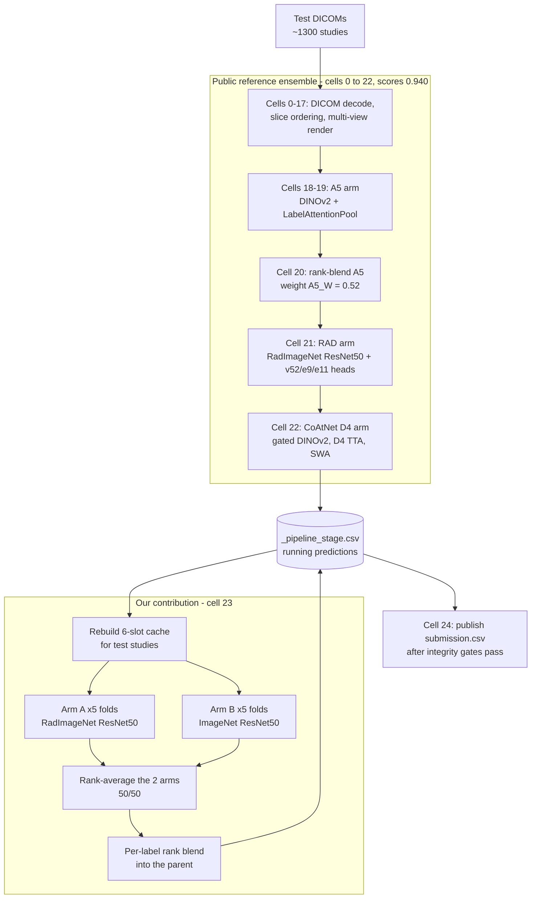
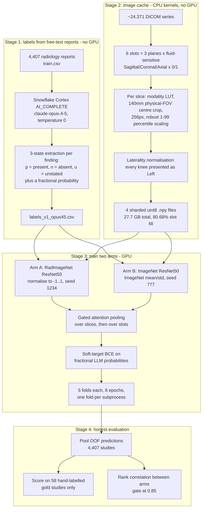

# RSNA Knee Abnormality Detection — 0.941 Public LB

An end-to-end, reproducible pipeline for the [RSNA Knee Abnormality Detection](https://www.kaggle.com/competitions/rsna-knee-abnormality-detection) Kaggle competition.

**Public leaderboard score: 0.941** (mean column-wise ROC AUC over 12 findings).
The public reference ensemble alone scores **0.940**; the two extra arms trained in this repository add **+0.001**.

> **Data source:** https://www.kaggle.com/competitions/rsna-knee-abnormality-detection/data
> You do **not** need to download the ~570 GB dataset locally. Every heavy step runs inside Kaggle kernels against the mounted competition data.

---

## Table of contents

1. [What this repository contains](#1-what-this-repository-contains)
2. [Background for newcomers](#2-background-for-newcomers)
3. [The submitted inference pipeline](#3-the-submitted-inference-pipeline)
4. [The model training pipeline](#4-the-model-training-pipeline)
5. [Repository layout](#5-repository-layout)
6. [Quick start: just submit the notebook](#6-quick-start-just-submit-the-notebook)
7. [Full reproduction guide](#7-full-reproduction-guide)
8. [Results](#8-results)
9. [What did not work, and why](#9-what-did-not-work-and-why)
10. [Credits and licensing](#10-credits-and-licensing)

---

## 1. What this repository contains

The competition asks for **12 independent binary predictions** per knee MRI study:

| # | Finding | # | Finding |
|---|---------|---|---------|
| 1 | ACL tear | 7 | Patellofemoral (PF) OA |
| 2 | MCL tear | 8 | Joint effusion |
| 3 | Medial meniscus tear | 9 | Synovitis |
| 4 | Lateral meniscus tear | 10 | Baker's cyst |
| 5 | Medial compartment OA | 11 | Bone contusion |
| 6 | Lateral compartment OA | 12 | Fracture |

Scoring is the **mean column-wise ROC AUC** — each finding is scored independently and the 12 AUCs are averaged. Only the *ranking* of studies within each column matters, not the absolute probability values. This fact drives a key design decision later (rank-based blending).

This repository provides three things:

1. **The complete submitted notebook** — the public reference ensemble with our two trained arms appended.
2. **Two trained model arms** (10 checkpoints: 2 arms x 5 folds) plus the code that produced them.
3. **A label-extraction pipeline** that converts free-text radiology reports into soft training targets using an LLM.

---

## 2. Background for newcomers

### "Pretrained" weights and transfer learning

Training from random numbers needs enormous data. Instead we start from weights already trained on a different, larger task, then *fine-tune* on ours. Which pretraining source you start from matters a great deal:

- **ImageNet** — 1.4M everyday photographs (cats, cars, furniture).
- **RadImageNet** — 1.35M medical radiology images. Much closer to knee MRI, and the community measured roughly **+0.063 AUC** over ImageNet on this competition.

### Folds, cross-validation, and out-of-fold predictions

We have 4,407 labelled studies. To estimate accuracy honestly you must evaluate on data the model never trained on. So we split the studies into **5 folds** (5 equal groups) and train 5 separate models:

| Model | Trains on | Predicts on |
|-------|-----------|-------------|
| fold 0 | folds 1,2,3,4 | fold 0 |
| fold 1 | folds 0,2,3,4 | fold 1 |
| ... | ... | ... |

Stitching those 5 prediction sets together gives one honest prediction for **every** study, where no prediction came from a model that saw that study in training. This is called **out-of-fold (OOF)** prediction, and it is the only trustworthy way to compare designs offline. At inference time we average all 5 fold models together, which is itself a small ensemble.

### Why rank-based blending

Because the metric is ROC AUC, only the *order* of studies matters. Two models can be on completely different scales (one outputs 0.01-0.10, another 0.30-0.90) yet rank studies identically and score identically. Averaging their raw probabilities would let the wider-scaled model dominate for no good reason.

The fix is to convert each model's predictions to **rank percentiles** (the lowest becomes 0.0, the highest 1.0) before averaging. This is lossless for AUC and requires no calibration between models. Every blend in this repository is rank-based.

---

## 3. The submitted inference pipeline

The submitted notebook is a 25-cell Kaggle notebook. Cells 0-22 are the **public reference ensemble** (from [Bend the Knee to Speedy Raptors](https://www.kaggle.com/code/mattiaangeli/bend-the-knee-to-speedy-raptors-the-original), which scores 0.940). Cell 23 is **our contribution**. Cell 24 publishes the file.

The pipeline uses a **staging file pattern**: `/kaggle/working/_pipeline_stage.csv` holds the current best predictions, and each arm reads it, blends itself in, and writes it back. That is why our arm can be *appended* without modifying any existing code.



### The integrity gates

Cell 24 refuses to publish unless:

- `_DINOV2_MATCHED_MEMBERS == 20` — all 20 DINOv2 ensemble members loaded
- `V18_CALIBRATOR_APPLIED` is true — the BTKD calibrator ran
- SHA256 fingerprints of the RAD weights match expected values

**This is why we append rather than edit.** Modifying a gated arm risks silently disabling the 0.940 baseline. Our cell also wraps everything in a try/except that restores the untouched staging file on any failure, so a bug in our arm can never corrupt a working submission.

### Per-label blend weights

Our arms do not enter uniformly. Each finding gets its own weight, derived from out-of-fold measurements (higher where our arm is both strong in absolute terms *and* reads something the radiology report omitted):

| Finding | Weight on our arms | Finding | Weight |
|---------|-------------------|---------|--------|
| Effusion | 0.38 | Medial Meniscus | 0.25 |
| Medial OA | 0.32 | ACL | 0.20 |
| Contusion | 0.32 | Lateral Meniscus | 0.18 |
| Fracture | 0.30 | Lateral OA | 0.15 |
| Baker's | 0.28 | MCL | 0.08 |
| Synovitis | 0.25 | PF OA | 0.08 |

Maximum 0.38 and mean 0.233 — the public ensemble stays the senior signal on all 12 findings. MCL and PF OA get near-zero weight because the reference is clearly better there.

---

## 4. The model training pipeline



### Design decisions that matter

**6-slot sampling.** A knee MRI study contains several series at different orientations and contrasts. We bin them into 6 fixed slots (3 anatomical planes x fluid-sensitive yes/no) and pick the deepest series for each slot. A presence mask tells the model which slots actually exist — about 81% are filled — so absent slots are masked out of attention rather than fed as zeros the model must learn to ignore.

**Physical-FOV cropping.** MRI pixel spacing varies between scanners. Cropping a fixed *pixel* box would produce inconsistent anatomical coverage. We crop a fixed **140 mm physical** field using the DICOM `PixelSpacing` tag, so the same anatomy fills the frame regardless of scanner.

**Laterality normalisation, and no horizontal flips.** Left and right knees are mirror images, so we flip every right knee to look left. This means horizontal flip augmentation is **forbidden** — four of the twelve labels (medial/lateral OA, medial/lateral meniscus) are defined by side, and flipping would silently swap them.

**Soft targets.** The LLM emits a fractional probability, not a hard 0/1. We train with BCE against that fraction, preserving the model's uncertainty. Rounding to 0/1 measurably hurt.

**Gated attention pooling** (Ilse et al.) rather than mean pooling, applied at two levels: over slices within a slot, then over slots within a study. Worth roughly +0.014 in this competition. Absent slots are masked to `-inf` before the softmax.

---

## 5. Repository layout

```
.
├── ref_kernel/                  Public reference notebook (0.940) + its metadata
├── push/                        Our verified copy of the 0.940 notebook
├── out/
│   ├── notebook_blend_full.ipynb    SUBMIT THIS - 0.941, full weights
│   └── notebook_blend_halved.ipynb  Hedge variant, also 0.941
│
├── sql/
│   ├── 01_setup_labels.sql      Snowflake schema for reports and labels
│   └── 02_prompt_v1.sql         The extraction prompt (view)
├── tools/
│   ├── load_reports.py          train.csv -> Snowflake
│   ├── extract_labels.py        Cortex AI_COMPLETE extraction, resumable
│   ├── export_labels.py         Snowflake -> labels_v1_opus45.csv
│   ├── validate_gold.py         Score labels against the 58 gold studies
│   ├── push_cache_kernel.py     Launch the 4 CPU cache-build shards
│   ├── check_cache.py           Verify cache integrity
│   ├── push_train_kernel.py     Launch arm A / arm B training
│   ├── push_probe_kernel.py     Launch a one-off CPU or GPU probe
│   ├── poll.py                  Poll kernel status until terminal
│   ├── eval_oof.py              Per-label OOF AUC vs the 58 gold studies
│   ├── arm_corr.py              Rank correlation + blend gain between arms
│   └── audit/repair helpers     Diagnostics described in section 9
├── cache/
│   └── build_cache.py           The 6-slot uint8 cache builder (runs on Kaggle)
├── train/
│   └── train_armA.py            BOTH arms - arm B is this file rendered with
│                                ENCODER="imagenet", MODEL_SEED=777
├── submit/
│   ├── blend_weights.py         Per-label weights + rationale
│   ├── make_blend_cell.py       Generates cell 23 and inserts it into the notebook
│   ├── stage_checkpoints.py     Verifies and stages the 10 checkpoints
│   ├── push_submission.py       Pushes the submission kernel
│   └── probe_test_meta.py       Verifies test-split metadata columns
├── labels_ds/
│   ├── labels_v1_opus45.csv     LLM soft labels for 4,407 studies
│   └── labels_v2_repaired.csv   Abandoned variant - see section 9
├── oof/                         Out-of-fold predictions, arm A, 5 folds
└── ckpt_ds/                     The 10 trained checkpoints — NOT in git.
                                 Download from the Kaggle dataset below.
```

### Where the trained weights live

The 10 checkpoints (981 MB total) are **not committed to git**. They are published as a public Kaggle dataset, which is the form the pipeline actually consumes — the submission kernel runs **offline** and mounts datasets rather than fetching from the network:

```
tejuuss/rsna-knee-arm-ckpts
```

Download them with:

```bash
kaggle datasets download -d tejuuss/rsna-knee-arm-ckpts -p ckpt_ds --unzip
```

| File | Fold | Best val macro AUC |
|------|------|--------------------|
| `armA_fold0.pt` … `armA_fold4.pt` | 0-4 | 0.8827 / 0.8808 / 0.8961 / 0.8747 / 0.8892 |
| `armB_fold0.pt` … `armB_fold4.pt` | 0-4 | 0.8914 / 0.8732 / 0.9060 / 0.8745 / 0.8874 |

All are 224 px input, 8 slices per slot.

---

## 6. Quick start: just submit the notebook

If you only want to reproduce the 0.941 score, you do not need to train anything.

1. **Upload the weights** as a Kaggle dataset (or use the public `tejuuss/rsna-knee-arm-ckpts`):
   ```bash
   kaggle datasets create -p ckpt_ds --dir-mode zip
   ```
2. **Push the notebook** — this attaches all 13 required datasets, 2 kernel sources and the DINOv2 model source automatically:
   ```bash
   python submit/push_submission.py --variant full
   ```
   This runs the notebook against the small *example* test set (3 studies, ~4 minutes). That is expected — it is a validation run, not the real one.
3. **Submit it**, which triggers the real ~6 hour run against the hidden ~1300 studies:
   ```bash
   kaggle competitions submit -c rsna-knee-abnormality-detection \
       -k <your-username>/rsna-knee-blend-full -v 1 -f submission.csv \
       -m "two-arm per-label rank blend"
   ```

### Prerequisites

```bash
pip install kaggle pandas numpy torch
```

Put your Kaggle API token at `~/.kaggle/kaggle.json` (or set `KAGGLE_CONFIG_DIR`). You must **accept the competition rules** on the competition page before the API will give you data access.

---

## 7. Full reproduction guide

This is the complete path from raw reports to a submitted notebook. Total cost: about **12 GPU-hours** plus a few CPU-hours and a handful of Snowflake credits.

### Step 1 — Extract labels from the radiology reports (no GPU)

The competition gives a free-text radiology report per training study, but no structured labels. We use an LLM to read each report and emit, for each of the 12 findings, one of three states plus a probability:

- `p` — the report explicitly states the finding is present
- `n` — the report explicitly states it is absent
- `u` — the report does not mention it at all

The three-state distinction matters: *unstated* is not the same as *absent*. Radiologists routinely omit findings they consider unremarkable.

```bash
# 1. Create the Snowflake schema
snow sql -c <your-connection> -f sql/01_setup_labels.sql
snow sql -c <your-connection> -f sql/02_prompt_v1.sql

# 2. Load the competition's train.csv reports
python tools/load_reports.py

# 3. Run the extraction (resumable; safe to re-run after interruption)
python tools/extract_labels.py

# 4. Export to CSV and sanity-check against the 58 gold studies
python tools/export_labels.py
python tools/validate_gold.py
```

Expected: 4,407 studies, 0 unparseable responses, gold macro AUC ~0.892.

Then upload the labels as a Kaggle dataset so the training kernels can read them:

```bash
kaggle datasets create -p labels_ds --dir-mode zip
```

> **No Snowflake?** Use the `labels_v1_opus45.csv` already committed in `labels_ds/`, or substitute any LLM API — the prompt is plain text in `sql/02_prompt_v1.sql`.

### Step 2 — Build the image cache (CPU kernels, no GPU quota)

Decoding 570 GB of DICOMs on every training epoch would be hopelessly slow. Instead we do it **once**, producing a compact uint8 tensor per study.

```bash
python tools/push_cache_kernel.py          # launches 4 CPU shards
python tools/poll.py rsna-knee-cache-shard-0 rsna-knee-cache-shard-1 \
                      rsna-knee-cache-shard-2 rsna-knee-cache-shard-3
python tools/check_cache.py                # verify integrity
```

Each shard emits `cache_shard<i>.npy` shaped `(studies, 6 slots, 16 slices, 256, 256)` plus a presence mask and a study index. Expected totals: 4,407 studies, 27.7 GB, 0 duplicates, 0 zero-slot studies, 80.68% slot fill.

These shards are consumed by the training kernels via `kernel_sources`, so they never need to leave Kaggle.

### Step 3 — Train the two arms (GPU, ~6 hours each)

```bash
# Arm A: RadImageNet ResNet50, all 5 folds in one kernel
python tools/push_train_kernel.py --folds 0 1 2 3 4

# Arm B: identical architecture, ImageNet weights, different init seed
python tools/push_train_kernel.py --folds 0 1 2 3 4 --armb

python tools/poll.py rsna-knee-armA-f01234 rsna-knee-armB-f01234
```

Kaggle allows only **2 concurrent GPU sessions**, so run these two and wait.

**Why one file for both arms.** `train/train_armA.py` is rendered by the pusher with `ENCODER="imagenet"`, `MODEL_SEED=777` and `RUN_PREFIX="armB"` substituted. The module graph is byte-identical, so arm B inherits arm A's proven memory and throughput profile — only the weight *values* and init seed differ. The fold-split seed stays at 1234 in both so their OOF predictions cover the same studies and can be blended.

**Each fold runs in its own subprocess.** A single long-lived process accumulated model, optimizer and DataLoader memory across folds and was killed by the OOM killer partway through fold 3. Subprocess isolation returns everything to the OS at each fold boundary.

Download the results:

```bash
kaggle kernels output <user>/rsna-knee-arma-f01234 -p armA_out
kaggle kernels output <user>/rsna-knee-armb-f01234 -p armB_out
```

> A kernel reporting `COMPLETE` does **not** guarantee it produced output — always check the file list. A run whose folds all crash inside subprocesses still reports COMPLETE with zero files.

### Step 4 — Evaluate honestly

```bash
# Per-label AUC on the 58 gold studies, vs the LLM labels as a reference
python tools/eval_oof.py --oof-glob "oof/armA_oof_fold*.csv"

# Rank correlation between the arms, and what a blend would buy
python tools/arm_corr.py --a oof/armA_oof_fold*.csv --b armB_out/armB_oof_fold*.csv
```

**Only judge on the 58 gold studies.** Cross-validation against the LLM soft labels measures agreement with the teacher, not correctness, and will happily reward a change that makes the model worse.

The correlation gate: below ~0.85 the arms are different enough that blending helps; above ~0.95 a blend adds nothing.

### Step 5 — Stage and publish the checkpoints

```bash
python submit/stage_checkpoints.py            # verifies fold + macro of each file
kaggle datasets create -p ckpt_ds --dir-mode zip
```

`stage_checkpoints.py` opens every checkpoint and checks its recorded fold and best macro AUC against the source run's log. This matters: two directories can contain an `armA_fold3.pt`, one from a crashed run, and shipping the wrong one costs accuracy with nothing in any log to show it.

### Step 6 — Generate the blend cell and submit

```bash
# Generate cell 23 and insert it at index 23 of the notebook
python submit/make_blend_cell.py --insert out/notebook_blend_full.ipynb
python submit/make_blend_cell.py --halved --insert out/notebook_blend_halved.ipynb

# Optional but recommended: test the inference path standalone first
python submit/make_blend_cell.py --test submit/test_blend.py
python tools/push_probe_kernel.py submit/test_blend.py rsna-knee-blend-test \
    --gpu --dataset <user>/rsna-knee-arm-ckpts

# Push and submit
python submit/push_submission.py --variant full
kaggle competitions submit -c rsna-knee-abnormality-detection \
    -k <user>/rsna-knee-blend-full -v 1 -f submission.csv -m "two-arm blend"
```

**How the blend cell is built.** Rather than reimplementing the preprocessing at inference time, `make_blend_cell.py` **splices** the geometry functions out of `cache/build_cache.py` and the model classes out of `train/train_armA.py` using Python's `ast` module, pasting them verbatim into the generated cell. There is exactly one definition of each, and it is the one the models were trained against. If a constant drifted — 130 mm instead of 140, a different resampler — the model would silently receive out-of-distribution inputs with no error raised.

The generator also runs an `ast`-based undefined-name check, because `compile()` validates syntax only. A cell that compiles and then raises `NameError` six hours into a submission run is the worst possible failure mode.

---

## 8. Results

### Out-of-fold, 4,407 studies, scored on the 58 gold studies

| | Gold macro AUC |
|---|---|
| Arm A (RadImageNet ResNet50) | 0.8955 |
| Arm B (ImageNet ResNet50) | 0.8892 |
| **50/50 rank blend of both arms** | **0.9078** |
| LLM labels (reference ceiling) | 0.8920 |

Mean rank correlation between the arms: **0.756** — decorrelated enough that blending them gained **+0.0123** over the better single arm.

### Per-label: where images beat the report, and where they do not

| Finding | Our image AUC | LLM label AUC | Delta |
|---------|---------------|---------------|-------|
| Effusion | 0.957 | 0.820 | **+0.137** |
| Baker's cyst | 0.913 | 0.831 | **+0.082** |
| Contusion | 0.947 | 0.865 | **+0.082** |
| Synovitis | 0.840 | 0.783 | **+0.057** |
| Medial OA | 0.947 | 0.905 | +0.042 |
| Fracture | 0.932 | 0.890 | +0.042 |
| Lateral OA | 0.857 | 0.847 | +0.010 |
| Medial meniscus | 0.934 | 0.955 | -0.021 |
| Lateral meniscus | 0.852 | 0.875 | -0.023 |
| ACL | 0.912 | 0.996 | **-0.084** |
| PF OA | 0.810 | 0.945 | **-0.135** |
| MCL | 0.846 | 0.992 | **-0.146** |

This split is medically coherent. Ligament and meniscus tears are stated explicitly and confidently by the radiologist, so the report is near-perfect and a 224 px model cannot match it. Fluid findings — effusion, Baker's cyst, synovitis — are frequently *not* mentioned but are visually obvious on fluid-sensitive sequences, so the image model genuinely knows more than the report. This asymmetry is what the per-label blend weights encode.

### Leaderboard

| Submission | Public LB |
|------------|-----------|
| Public reference ensemble | 0.940 |
| **+ our two arms, full weights** | **0.941** |
| + our two arms, halved weights | 0.941 |

> **Caveat on the gold numbers.** The 58 gold studies are roughly 3x enriched for positives relative to the corpus (ACL 41% vs 13%), and several findings have fewer than 15 positives. Treat the *ordering* as real and the magnitudes as approximate. The measurement noise floor is about 0.003.

---

## 9. What did not work, and why

Recording failures is more useful than recording successes. These are all measured results, not speculation.

### The arms were redundant with the baseline — this is the main lesson

Both submissions scored **exactly 0.941**, at full weights and at halved weights. A 2x change in our arms' influence moved nothing, which means their contribution was indistinguishable from noise.

The reason is visible in cell 21 of the reference notebook:

```python
self.backbone = nn.Sequential(*list(resnet50(weights=None).children())[:-2])
return self.backbone(image).mean(dim=(2, 3))
```

That is architecturally identical to our arm A encoder, loading the **same** `ResNet50.pt` from the **same** `marwanmath/resnet-50-radimagenet-marwan` dataset — and the baseline already ensembles three RadImageNet head variants. We built a fourth copy of a component the ensemble already contained.

The methodological error: we measured rank correlation **between our own two arms** (0.756, comfortably decorrelated) and never against the baseline. That answered "are A and B different from each other" when the question was "is either different from what is already in the ensemble".

**Takeaway:** before training anything to append to an ensemble, inventory every encoder and weight file that ensemble already loads.

### Out-of-fold label repair made things worse

The idea: where a report is silent (`u`) but the model confidently predicts positive, mix the model's own out-of-fold prediction into the training target. This is self-distillation, and the gold studies suggested 14 of 41 silent Synovitis cells were recoverable false negatives.

Retraining on repaired labels moved gold macro from **0.8955 to 0.8891**, and the two repaired findings were themselves the biggest losers:

| Finding | v1 labels | repaired | Change |
|---------|-----------|----------|--------|
| Synovitis (w=0.60) | 0.840 | 0.802 | **-0.038** |
| Effusion (w=0.50) | 0.957 | 0.942 | **-0.015** |

Against a 0.003 noise floor, -0.038 is roughly 12x noise. The repair rewrote 3,803 of 4,407 Synovitis cells (86%); self-distillation on silent cells mostly reinforces what the model already believes, so systematic error swamped the genuine recoveries. `labels_v2_repaired.csv` is kept in the repo only as a negative result. **Use `labels_v1_opus45.csv`.**

### CoAtNet was abandoned on T4 hardware

The original plan for arm B was CoAtNet (attention-convolution hybrid) for maximum architectural difference. All 5 folds were killed by the host OOM killer, and profiling showed **2.57 s/step versus ResNet50's 0.30 s/step** — roughly 8.5x slower at comparable FLOPs, because Kaggle's Turing T4 GPUs have no fast attention kernels. One fold would have taken ~10 hours.

Arm B was rebuilt as arm A with only the pretraining source and seed changed, which guaranteed the memory and throughput profile rather than rediscovering it.

### A directory walk cost 50x the inference budget

The first end-to-end inference test measured 143 s/study, projecting **51.6 hours** against a 9-hour limit. Phase timing showed decode was only 0.9 s/study and GPU 1.6 s/study — **251 of 276 seconds** were `os.walk("/kaggle/input")` recursively traversing the mounted competition tree (24,371 series directories of DICOMs) to locate 10 checkpoint files.

Pruning the walk and early-exiting brought discovery from 251 s to **0.0 s**, and the real budget to about 1 hour.

A related measurement error: extrapolating `total_elapsed / n_studies` from a 3-study run folds the one-time fixed cost into the per-study figure and overstated the real run by 5x. Always extrapolate **marginal** cost.

### Engineering traps worth knowing

| Trap | Consequence |
|------|-------------|
| Kaggle kernel slug derives from the **title**, not the metadata `id` | status and output lookups 404 |
| `kaggle kernels push` exits 0 even when rejected | phantom "successful" pushes; check for the literal success string |
| Max 2 concurrent batch GPU sessions; a 3rd is **rejected**, not queued | silently lost training runs |
| `COMPLETE` status does not imply output was produced | always check the output file list |
| `compile()` validates syntax but not names | added an `ast`-based undefined-name check |
| Jupyter `source` must be lines **with** newlines | `split("\n")` collapses a cell to one line: valid JSON, broken code |
| `resize` is a try/except (cv2 `INTER_AREA` else PIL `BILINEAR`) | different pixels; splice the whole block and log which is live |
| Substring checks are not verification | `"LABELS ="` matched `_BL_LABELS =` and falsely reported success |

### Honest accounting

Roughly **24.6 GPU-hours** were consumed and about **12.3 hours (50%)** outright wasted, for a net leaderboard gain of **+0.001**. Notably, none of the wasted time went to the engineering bugs above — those were all caught cheaply. It went to two *strategic* errors: training a redundant arm, and pursuing label repair. Both were failures to measure before spending.

### Context on the ceiling

At the time of writing, the leaderboard leader scored **0.958**, with places 2-13 packed between 0.954 and 0.956. The best **public** notebooks score **0.941-0.943** — one is titled *"Why Public Forks Stop at 0.941"*. Our 0.941 matches the public ceiling; the 0.954+ tier is private work.

A structural constraint governs any approach like this one: you cannot retrain the frozen baseline's arms, only append to them. Since an appended arm enters at a weight of at most ~0.4, its contribution is bounded by that weight no matter how good it is.

---

## 10. Credits and licensing

### Built on the work of others

- **Public reference ensemble** — [Mattia Angeli, *Bend the Knee to Speedy Raptors*](https://www.kaggle.com/code/mattiaangeli/bend-the-knee-to-speedy-raptors-the-original) and the DINOv2/CoAtNet lineage it draws on. Cells 0-22 of the submitted notebook are that work; we added only cell 23.
- **RadImageNet** — ResNet50 weights via `marwanmath/resnet-50-radimagenet-marwan`.
- **DINOv2** — Meta AI, via Kaggle Models `metaresearch/dinov2`.
- **Gated attention pooling** — Ilse, Tomczak & Welling, *Attention-based Deep Multiple Instance Learning* (2018).
- **Competition and data** — RSNA, via [the competition data page](https://www.kaggle.com/competitions/rsna-knee-abnormality-detection/data).

### Datasets attached to the submitted notebook

All 13 are required — each is loaded by some arm of the pipeline, and a missing one raises rather than degrading gracefully:

```
dreaddevelopment/raptor-knee-maxspan              dreaddevelopment/raptor-knee-native384
dreaddevelopment/raptor-knee-native384dense       mattiaangeli/knee-mri-fold-weights
mattiaangeli/opencv-python-headless-4120088-x86   marwanmath/resnet-50-radimagenet-marwan
mattiaangeli/rsna-knee-coat-resgated-ep10-top3    mattiaangeli/rsna-knee-coatnet-d4-depthzone-swa3-b2
antoinegg1/rsna-knee-e11-diverse-heads-v20        antoinegg1/rsna-knee-e9-radimagenet-heads-v15
pilkwang/rsna-knee-llm-labels                     prvsiyan/rsna-knee-v52-radimagenet-heads-20260812
pilkwang/rsna-knee-weights                        + tejuuss/rsna-knee-arm-ckpts (ours)
```

Plus kernel sources `sofiaanjenje/rsna-knee-e11-train` and `sofiaanjenje/rsna-knee-e13-train`, and model source `metaresearch/dinov2/PyTorch/small/1`.

### Licence

Our code and trained checkpoints are released under the **MIT Licence**. Third-party weights remain under their original licences — check each before any commercial use. Competition data is governed by the RSNA competition rules.

### Not for clinical use

This is competition code. It has not been validated for clinical or diagnostic use and must not be used to inform patient care.
